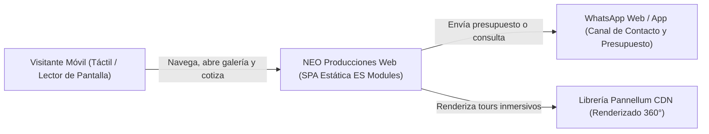
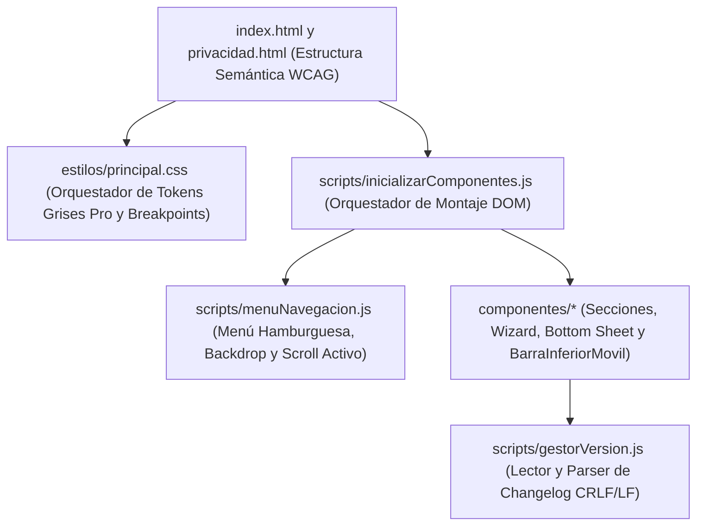
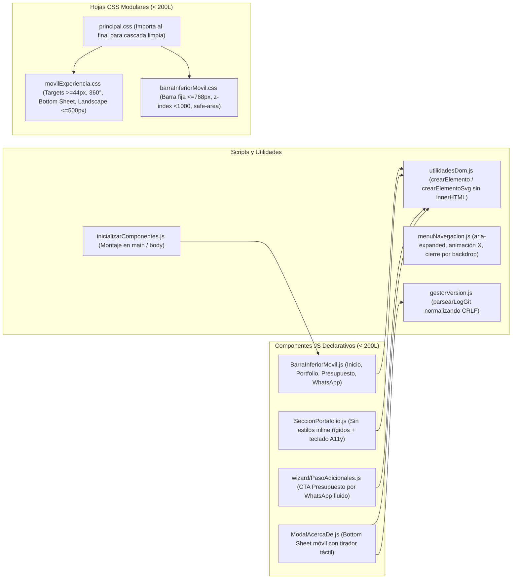
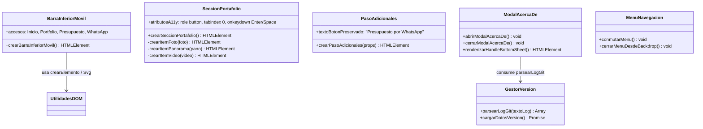

# Arquitectura C4: Adaptación Mobile-First y Experiencia Táctil (`SPEC-UI-004`)

**Estado:** Aprobado por el Usuario  
**Trazabilidad:** `especificaciones/especificacionAdaptacionMovil.md` (`SPEC-UI-004`)

---

## 1. Nivel 1 — Diagrama de Contexto del Sistema

Muestra la interacción del usuario móvil (orientación vertical estándar `390x844`, compacto `360x740` y horizontal `844x390`) con la plataforma estática de NEO Producciones y sus canales externos.

---

## 2. Nivel 2 — Diagrama de Contenedores

La solución evita añadir frameworks o dependencias externas pesadas. Toda la lógica de interfaz, navegación y responsividad se organiza en contenedores estáticos HTML, hojas CSS modulares y módulos ES nativos del navegador.

---

## 3. Nivel 3 — Diagrama de Componentes (Módulos Nuevos y Modificados)

Para respetar la **Regla de Hierro (< 200 líneas/archivo)** dado que `visorMultimedia.css` (195L), `presupuesto.css` (195L), `modalAcercaDe.css` (194L) y `responsivo.css` (154L) están cerca del límite, las mejoras responsivas y la barra inferior móvil se aíslan en módulos CSS y JS dedicados al final de la cascada.

---

## 4. Nivel 4 — Código, Contratos e Interfaces de Módulos

---

## 5. Fronteras Arquitectónicas y Cumplimiento de Invariantes

1. **Límite de Líneas (`<= 200` líneas por archivo):** Ningún archivo JS, CSS, HTML o MD superará las 200 líneas tras la implementación. Los estilos de `SPEC-UI-004` se distribuyen entre `estilos/movilExperiencia.css` y `estilos/barraInferiorMovil.css` al final de `estilos/principal.css`.
2. **Invariantes del Contrato de Tests Existente (`tests/presupuesto/vistaPresupuestoMovil.test.js`):**
   - Se conserva literal el texto `'Presupuesto por WhatsApp'` y `'← Volver'` en `componentes/wizard/PasoAdicionales.js`.
   - Se mantienen `.wizard-actions-bar.dual { flex-direction: row }`, `.wizard-services-grid { grid-template-columns: 1fr }` y `.wizard-extras-grid` con `overflow-y: auto`.
3. **Jerarquía de Capas (`z-index`) y Safe Area:**
   - `BarraInferiorMovil` visible solo en `@media (max-width: 768px)` con `z-index` inferior a `1000` (por debajo de `.mobile-menu`, `#lightbox` y `#modal-acerca-de`) y padding inferior con `env(safe-area-inset-bottom)`.
4. **Seguridad y Cero Suposiciones:** Uso exclusivo de `crearElemento` / `crearElementoSvg` (0 usos de `innerHTML`), `<button type="button">` nativos en disparadores interactivos y parsing seguro CRLF/LF en `parsearLogGit`.
