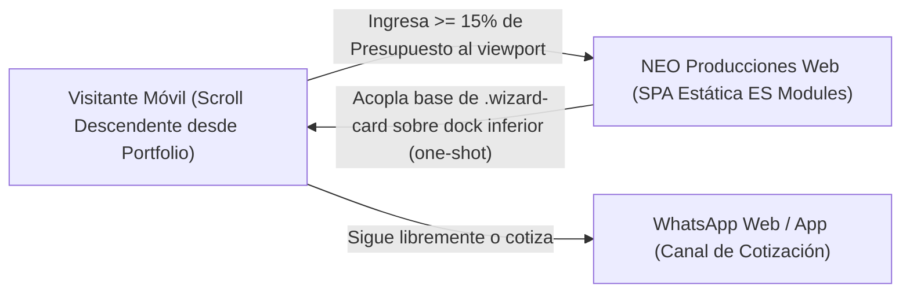
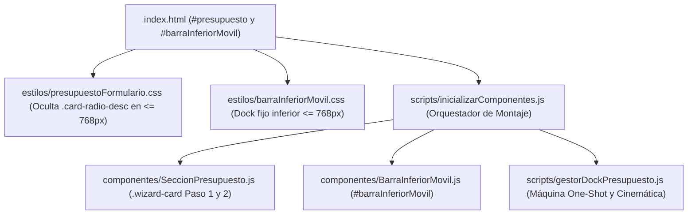
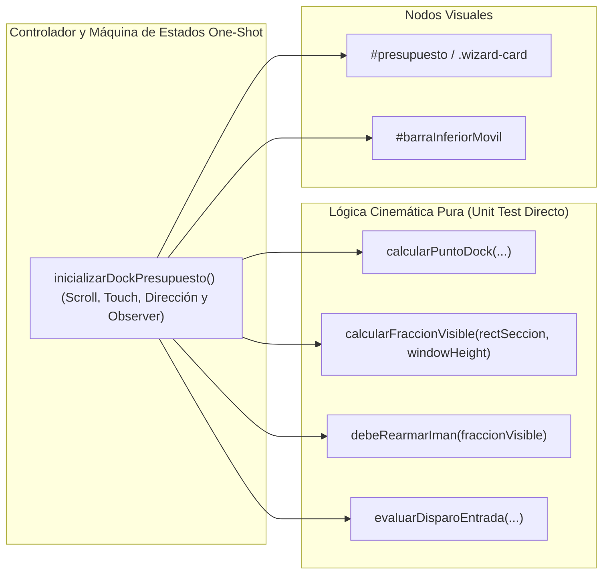
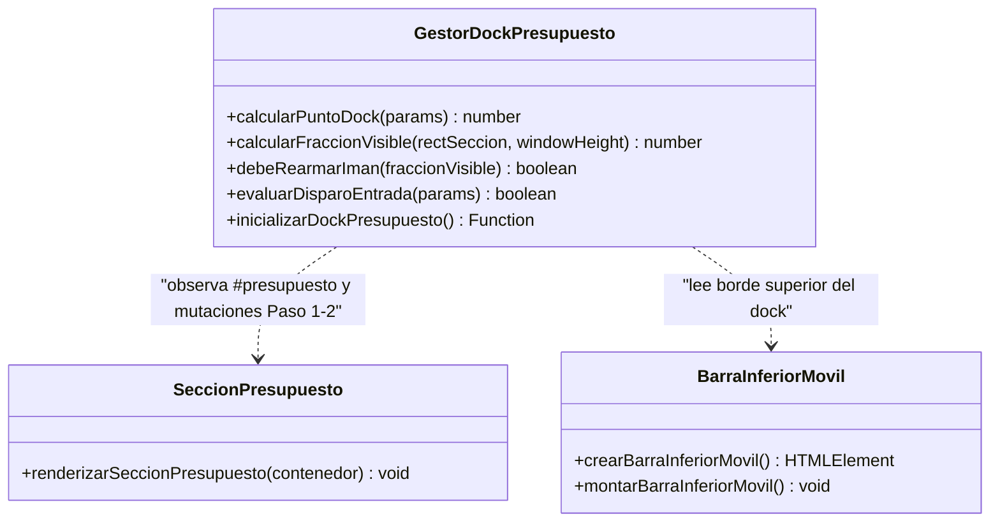

# Arquitectura C4: Acoplamiento Magnético ("Dock") de Presupuesto Móvil (`SPEC-UI-005 Rev. 2`)

**Estado**: Aprobado por el Usuario  
**Trazabilidad**: `especificaciones/especificacionDockPresupuestoMovil.md` (`SPEC-UI-005 Rev. 2`)

---

## 1. Nivel 1 — Diagrama de Contexto del Sistema

Describe la interacción del visitante móvil que desciende desde la galería hacia Presupuesto y obtiene el encuadre automático por entrada en viewport.

---

## 2. Nivel 2 — Diagrama de Contenedores

La solución se organiza en contenedores estáticos HTML, hojas CSS modulares y módulos ES nativos sin dependencias externas.

---

## 3. Nivel 3 — Diagrama de Componentes

Separa estrictamente las funciones matemáticas y de decisión puras del controlador de eventos del navegador y los nodos visuales del DOM.

---

## 4. Nivel 4 — Código, Contratos e Interfaces

### Contratos de Funciones Puras (`scripts/gestorDockPresupuesto.js`)
1. **`calcularPuntoDock({ rectInferiorAbsoluto, windowHeight, alturaBarraInferior }) => number`**:
   Retorna `Math.max(0, Math.round(rectInferiorAbsoluto - windowHeight + alturaBarraInferior))` (o `0` ante parámetros inválidos/`NaN`).
2. **`calcularFraccionVisible(rectSeccion, windowHeight) => number`**:
   Calcula la fracción visible (`0..1`) de `#presupuesto` dentro del viewport: `Math.max(0, Math.min(rectSeccion.bottom, windowHeight) - Math.max(rectSeccion.top, 0)) / rectSeccion.height`.
3. **`debeRearmarIman(fraccionVisible) => boolean`**:
   Devuelve `true` cuando `fraccionVisible <= 0` (la sección salió por completo del viewport).
4. **`evaluarDisparoEntrada({ anchoVentana, barraPresente, fraccionVisible, direccionDescendente, yaDisparadoEnEntrada, velocidadPxMs, umbralEntrada = 0.15, umbralVelocidad = 1.8 }) => boolean`**:
   Habilita el disparo solo si `anchoVentana <= 768`, `barraPresente === true`, `direccionDescendente === true`, `yaDisparadoEnEntrada === false`, `Math.abs(velocidadPxMs) <= umbralVelocidad` y `fraccionVisible >= umbralEntrada`.
5. **`inicializarDockPresupuesto() => Function`**:
   Registra oyentes pasivos (`scroll`, `touchstart`, `touchend`), actualiza dirección e historial *one-shot*, rearma al llegar a `0%` visible y usa `MutationObserver` para re-acoplar suavemente al cambiar entre Paso 1 y Paso 2.

---

## 5. Invariantes y Fronteras Arquitectónicas

1. **Límite de Líneas (`<= 200` líneas)**: Todo módulo involucrado se mantiene estrictamente por debajo de 200 líneas.
2. **Cero Scroll-Jacking (One-Shot por Entrada)**: Una vez acoplado, el imán se desarma hasta que `#presupuesto` abandona por completo el viewport, y nunca interrumpe *fast swipes* continuos.
3. **Aislamiento Total en Escritorio (`> 768px`)**: Si el viewport excede 768px, no registra oyentes ni modifica estilos.
4. **Validación Defensiva**: Todas las funciones puras validan `NaN`, nulos y divisores no positivos (`height <= 0`).
