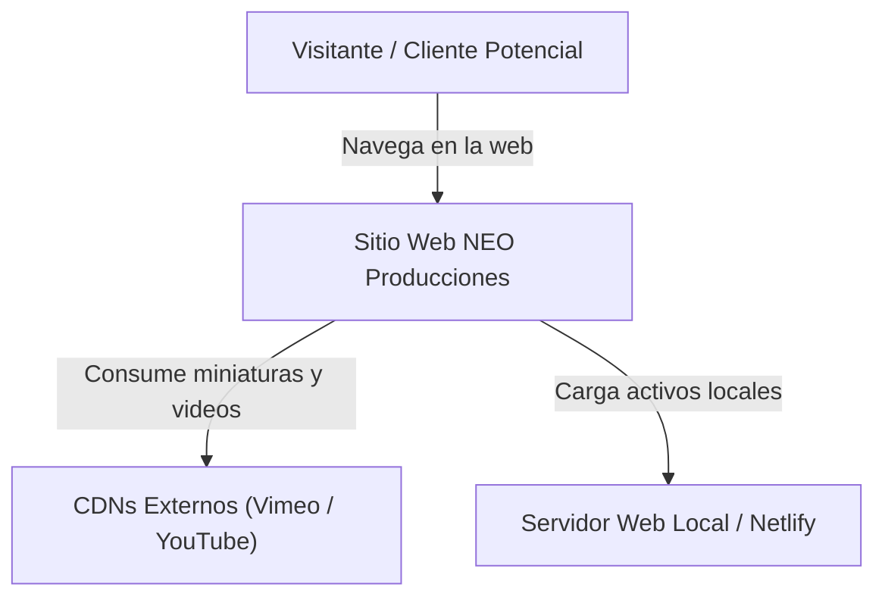
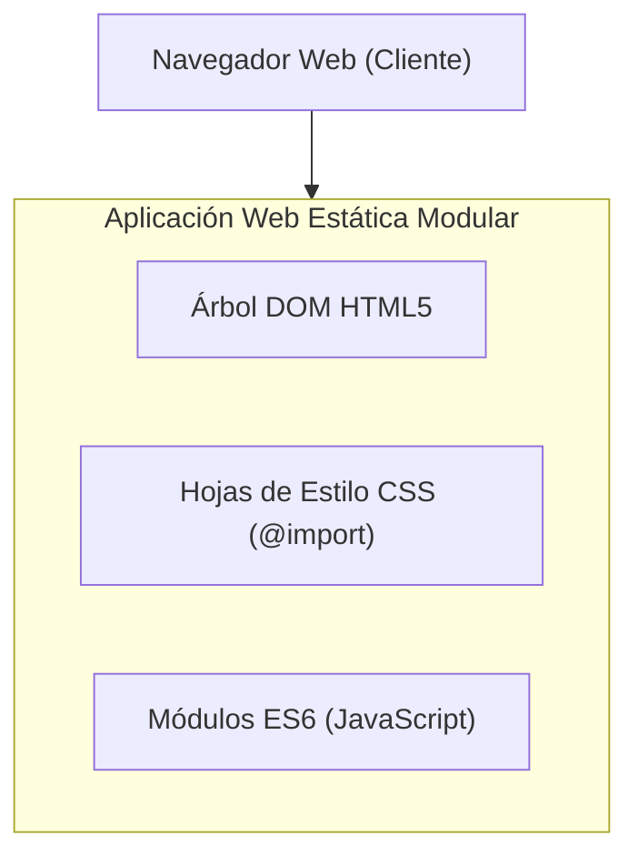
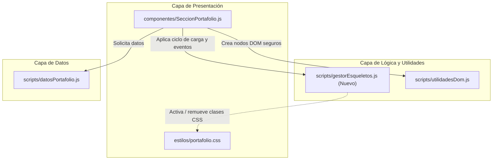
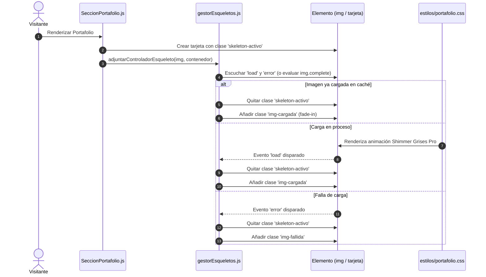

# Arquitectura C4: Sistema de Skeletons y Portafolio Multimedia

**Proyecto**: NEO Producciones  
**Módulo**: Portafolio Multimedia & Skeletons de Carga  
**Fecha**: 2026-10-15  

---

## Nivel 1: Contexto del Sistema

---

## Nivel 2: Contenedores

---

## Nivel 3: Componentes

---

## Nivel 4: Código y Flujo Detallado

---

## Decisiones Técnicas y Modularización
1. **Nuevo submódulo `scripts/gestorEsqueletos.js`**:
   - Mantendrá la lógica de suscripción de eventos `load` y `error`, y la detección de `img.complete` de manera pura y reutilizable.
   - Garantiza que `SeccionPortafolio.js` se mantenga por debajo del límite estricto de 200 líneas (actualmente tiene 113 líneas; modularizar la lógica de carga evita inflarlo).
2. **Estilos en `estilos/portafolio.css`**:
   - Variables de color Grises Pro integradas.
   - Clases `.esqueleto-activo`, `.img-cargada`, `@keyframes esqueletoBrillo` con soporte `prefers-reduced-motion`.
