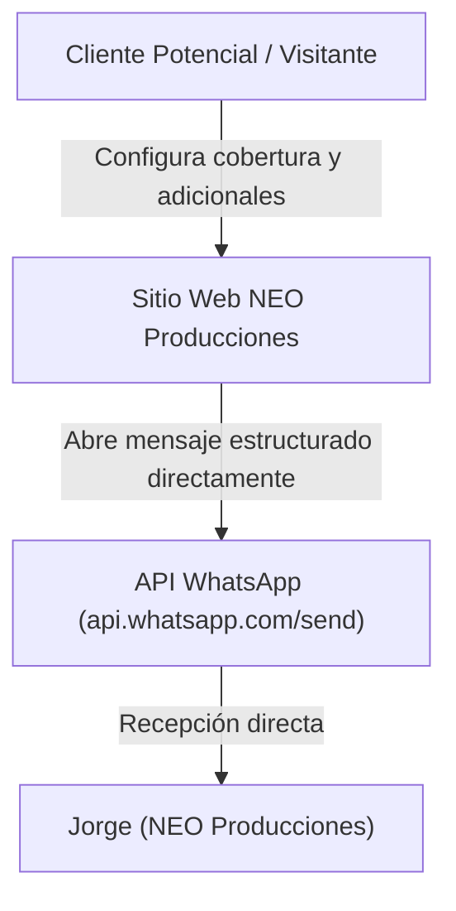
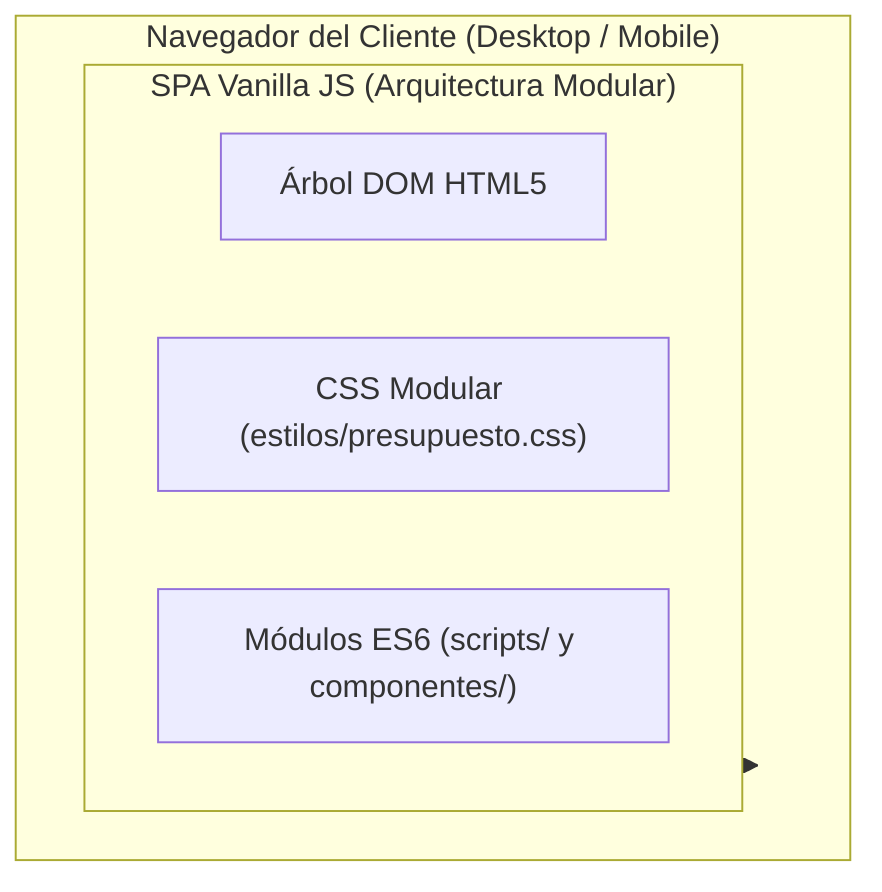
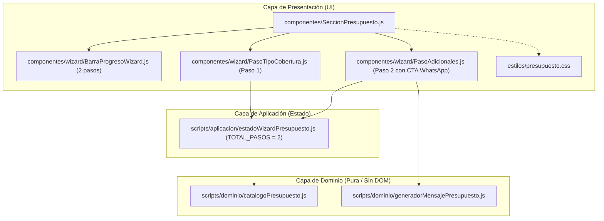
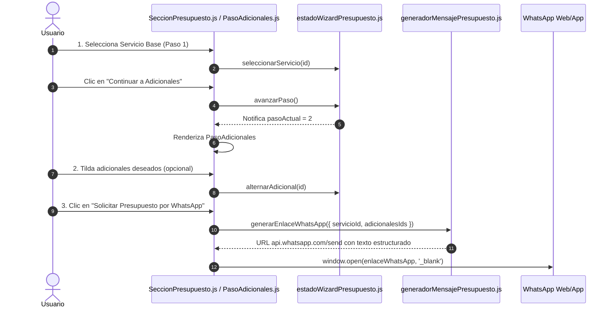

# Arquitectura C4: Wizard Consultivo de Presupuesto

**Proyecto**: NEO Producciones  
**Módulo**: Asistente Wizard de Presupuesto (`componentes/wizard/`, `componentes/SeccionPresupuesto.js`, `estilos/presupuesto.css`)  
**Fecha**: 2026-10-22  
**Autor**: Asistente de IA (Antigravity) / Jorge  
**Estado**: Aprobado por el Usuario  

---

## Nivel 1: Contexto del Sistema

---

## Nivel 2: Contenedores

---

## Nivel 3: Componentes y Separación de Capas

---

## Nivel 4: Flujo y Máquina de Estados del Wizard (2 Pasos)

