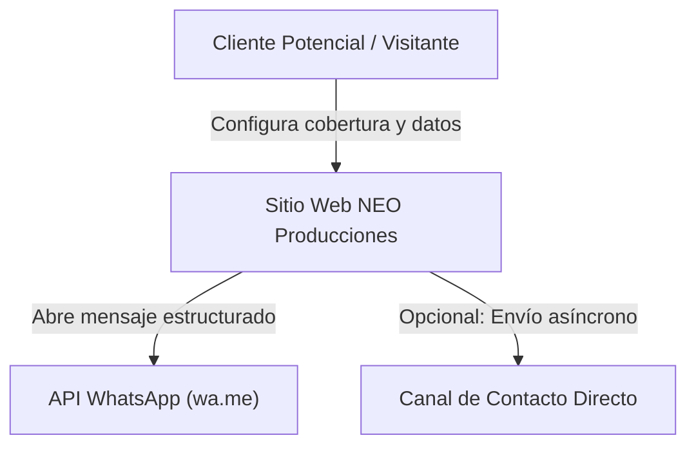
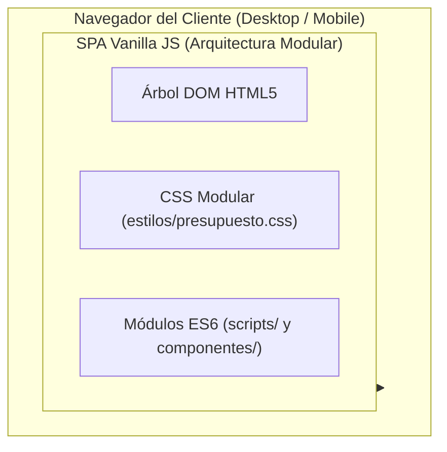
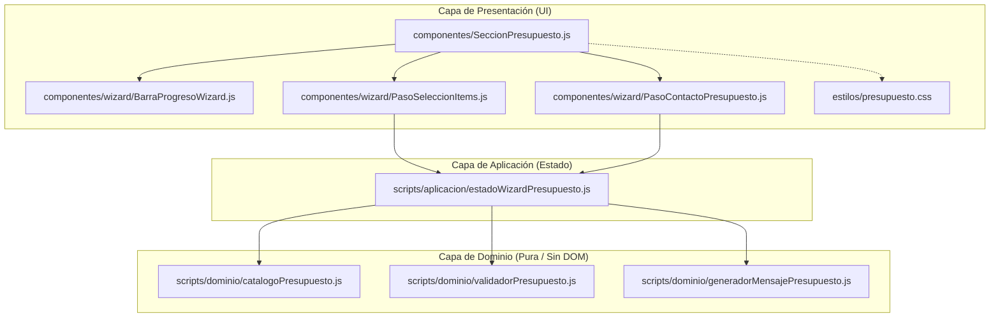
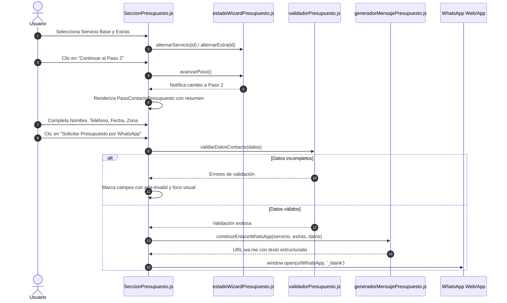

# Arquitectura C4: Wizard Consultivo de Presupuesto

**Proyecto**: NEO Producciones  
**Módulo**: Asistente Wizard de Presupuesto (`componentes/wizard/`, `componentes/SeccionPresupuesto.js`, `estilos/presupuesto.css`)  
**Fecha**: 2026-10-16  
**Autor**: Asistente de IA (Antigravity) / Jorge  
**Estado**: En Revisión (Esperando Aprobación de Compuerta C4)

---

## Nivel 1: Contexto del Sistema

---

## Nivel 2: Contenedores

---

## Nivel 3: Componentes y Separación de Capas

---

## Nivel 4: Flujo y Máquina de Estados del Wizard

---

## Invariantes y Reglas de Diseño

1. **Aislamiento del Dominio**:
   - `catalogoPresupuesto.js`, `validadorPresupuesto.js` y `generadorMensajePresupuesto.js` son funciones y constantes puras sin acceso a `document`, `window` ni dependencias externas.
   - Son 100% testeables de forma determinista mediante `node --test tests/presupuesto/*.test.js`.
2. **Límite Estricto de 200 Líneas**:
   - Cada componente del wizard (`BarraProgresoWizard.js`, `PasoSeleccionItems.js`, `PasoContactoPresupuesto.js`, `SeccionPresupuesto.js`) se mantiene por debajo de 150 líneas.
3. **UX Reactiva y Accesibilidad (WCAG 2.1 AA)**:
   - Anillos de foco visibles (`focus-visible`).
   - Transiciones suaves entre pasos sin parpadeos.
   - Respaldo de navegación por teclado completa (`Tab`, `Space`, `Enter`).
