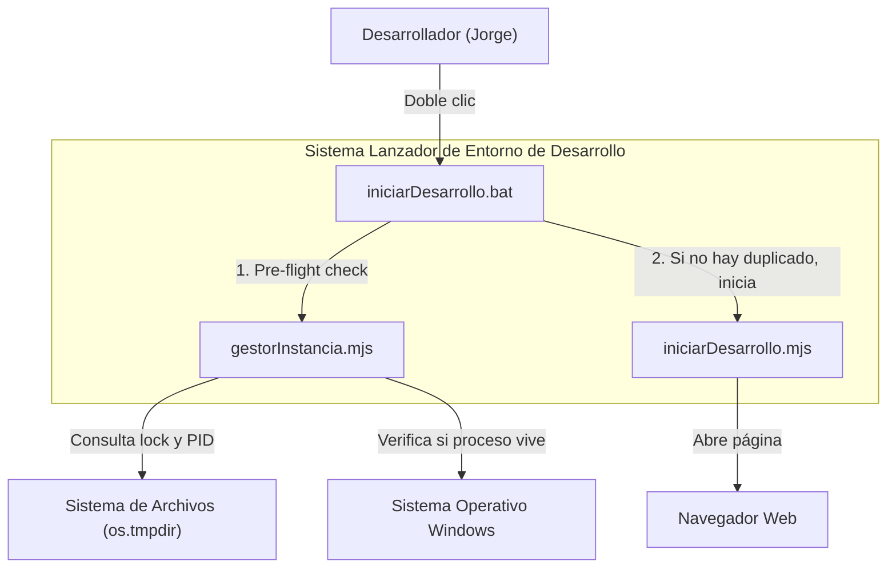
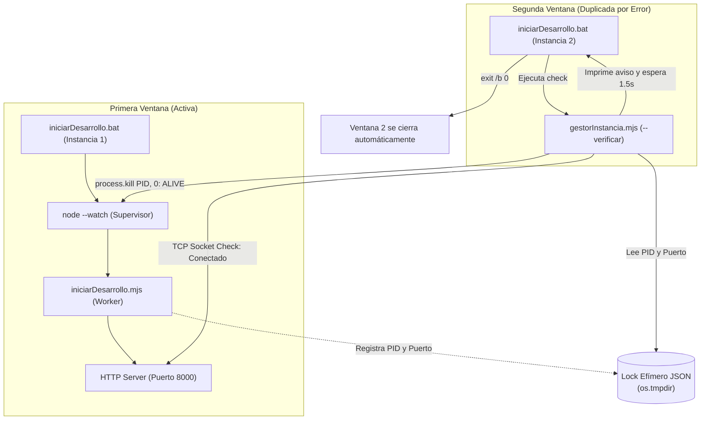
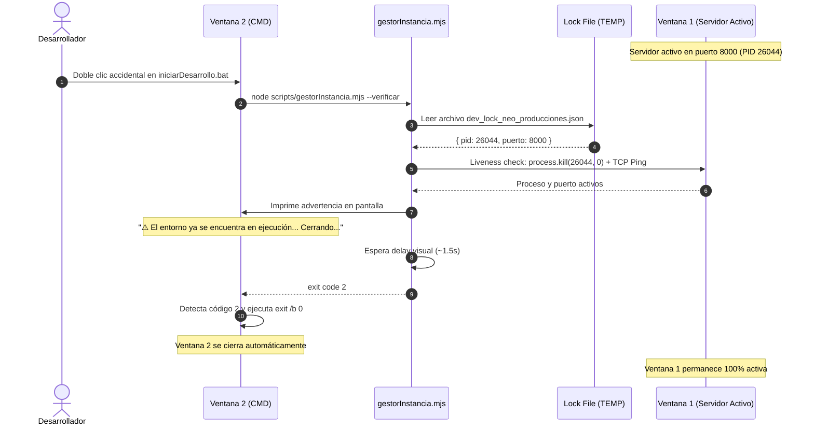

# Diseño de Arquitectura C4: Detección de Instancia Única en Lanzador de Desarrollo

## 1. Contexto del Sistema (Nivel 1)

---

## 2. Diagrama de Contenedores y Componentes (Nivel 2 y 3)

---

## 3. Diagrama de Secuencia: Detección y Cierre Automático

---

## 4. Invariantes Arquitectónicos
1. **Regla de Hierro (< 200 líneas)**: `gestorInstancia.mjs` y `iniciarDesarrollo.mjs` se mantienen modularizados por debajo de las 200 líneas.
2. **Resiliencia ante Locks Obsoletos**: Si el proceso registrado en el lock murió bruscamente, el lock se purga de inmediato y se arranca sin trabas.
3. **Cierre sin Errores**: La salida de la ventana duplicada usa `exit /b 0` en el `.bat`, evitando entrar en bloques de error o disparar `pause`.
