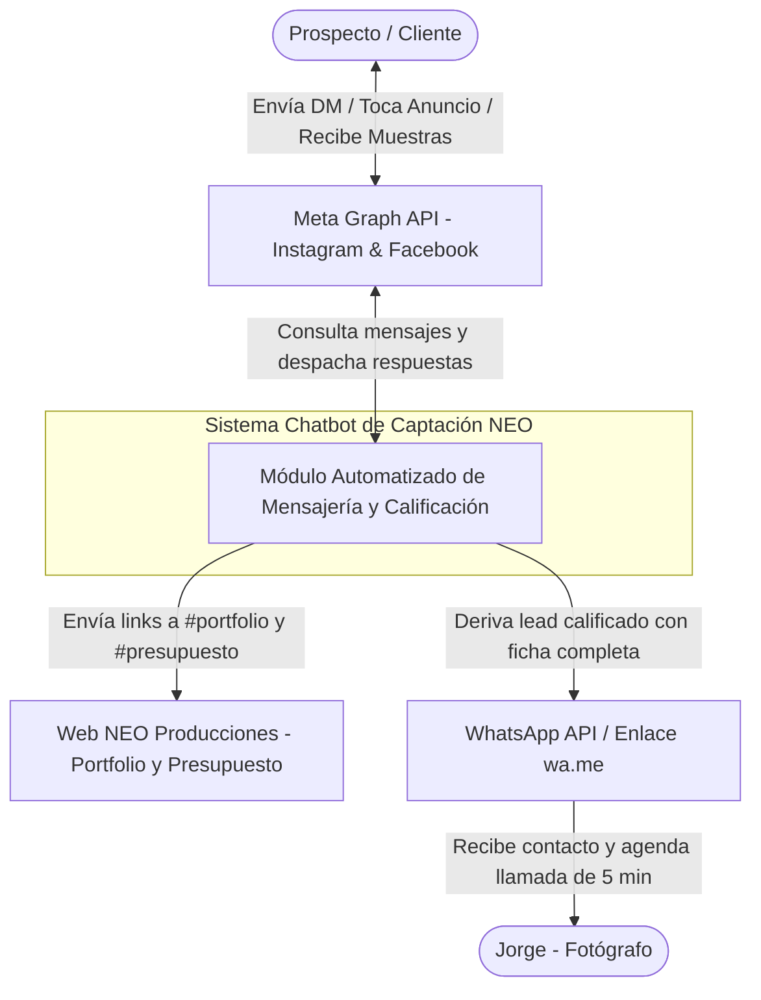
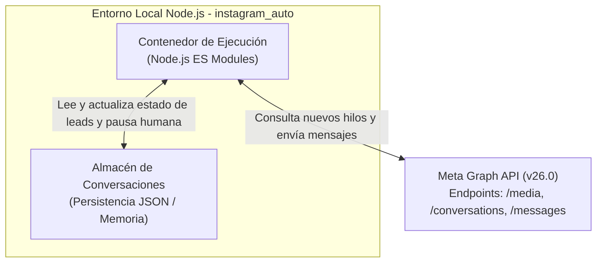
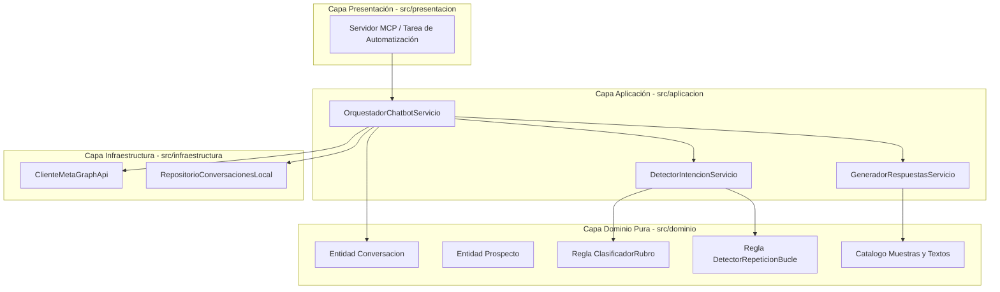

# Arquitectura C4: Chatbot de Captación NEO Producciones

## Nivel 1: Diagrama de Contexto del Sistema
Delimita los actores humanos, el sistema y los servicios externos involucrados.

---

## Nivel 2: Diagrama de Contenedores
Estructura de ejecución y almacenamiento del sistema en `instagram_auto`.

---

## Nivel 3: Diagrama de Componentes (Clean Architecture)
Separación estricta en capas con dirección unidireccional de dependencias hacia el Dominio.

---

## Nivel 4: Código y Contratos de Clases

### 1. Dominio Puro (`src/dominio/`) - Cero dependencias externas
* `clasificadorRubro.js`: Identifica si el texto/evento es `sociales`, `corporativos`, `sesiones` o `comercial` (inmuebles).
* `detectorRepeticionBucle.js`: Evalúa si un botón fue presionado repetidamente en una ventana de 15 segundos.
* `conversacion.js`: Maneja la máquina de estados del embudo y la bandera `pausaHumanaHasta`.
* `catalogoMuestras.js`: Asocia cada rubro con sus 2 imágenes destacadas y sus textos en voseo.

### 2. Aplicación (`src/aplicacion/`)
* `orquestadorChatbotServicio.js`: Recibe los hilos de Facebook e Instagram, filtra mensajes nuevos, detecta intervención de Jorge, evalúa el estado y envía la respuesta correspondiente vía `ClienteMetaGraphApi`.
* `esquemasValidacionChatbot.js`: Esquemas Zod para validar cargas útiles de mensajes y parámetros.

### 3. Infraestructura (`src/infraestructura/`)
* `clienteMetaGraphApi.js`: Extendido con los métodos `obtenerConversacionesBandeja(plataforma)` y `enviarMensajeRespuesta(hiloId, texto, urlsAdjuntos)`.
* `repositorioConversacionesLocal.js`: Guarda el histórico de leads calificados y marcas de tiempo de intervención humana en `.datos/conversaciones.json`.
