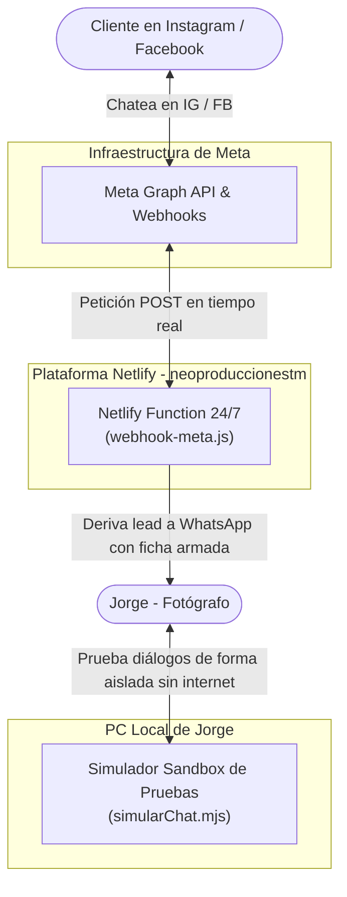
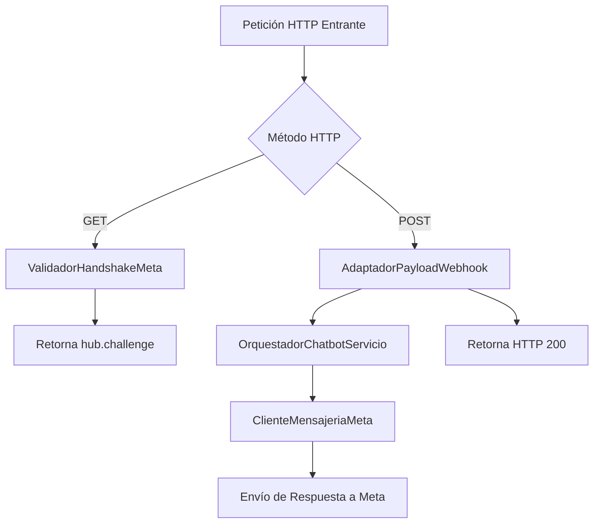

# Arquitectura C4: Webhook Netlify y Simulador de Pruebas

## Nivel 1: Contexto de Despliegue en la Nube
El sistema opera 24/7 en la infraestructura serverless de Netlify sin depender de la PC encendida.

---

## Nivel 2: Contenedores y Componentes del Webhook
Estructura modular del endpoint en `netlify/functions/webhook-meta.js`.

---

## Nivel 3: Componentes y Contratos de Código

1. **`src/aplicacion/adaptadorWebhookMeta.js`**:
   - `verificarSuscripcion(queryParams, tokenEsperado)`: Valida `hub.mode` y `hub.verify_token`.
   - `extraerMensajesEntrantes(payload)`: Normaliza el JSON complejo de Meta a una estructura limpia `{ emisorId, receptorId, texto, marcaTiempo, canal }`.

2. **`netlify/functions/webhook-meta.js`**:
   - Función serverless estándar de Netlify (`export default async (req, context) => ...`).
   - Responde inmediatamente para cumplir el SLA de Meta (< 3 segundos).

3. **`scripts/simularChat.mjs`**:
   - Arnés interactivo de terminal para simular prospectos, botones FAQ, clics repetidos y pausa humana.
