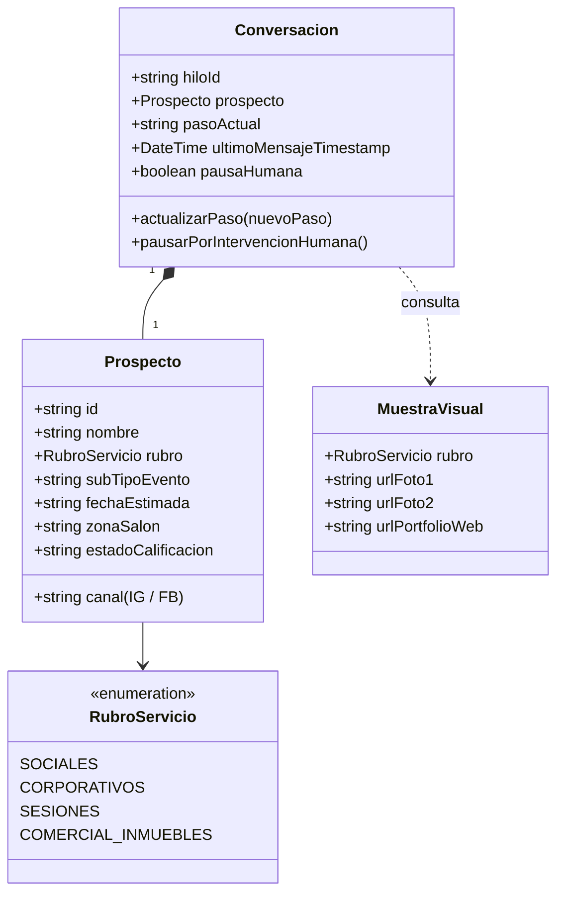

# Modelo de Dominio y Lenguaje Ubicuo: Chatbot de Captación

## 1. Glosario de Términos (Ubiquitous Language)
* **Prospecto (Lead):** Persona que inició contacto por Instagram Direct o Facebook Messenger consultando por servicios de NEO Producciones.
* **Rubro del Servicio:** Categoría raíz alineada al Wizard web:
  - `sociales`: Bodas, 15 años, Bar/Bat Mitzvá, 18 años, 1er añito, Bautismos, Comuniones, Aniversarios.
  - `corporativos`: Conferencias, congresos, jornadas empresariales.
  - `sesiones`: Pre-boda, book de 15, retratos personales.
  - `comercial`: Fotografía de inmuebles, arquitectura, locales y productos.
* **Estado de Calificación:**
  - `NO_CALIFICADO`: Solo interactuó con botones o saludos iniciales.
  - `CALIFICADO_PARCIAL`: Informó evento, pero falta fecha o salón.
  - `CALIFICADO_COMPLETO`: Se conoce evento, fecha estimada y zona/salón.
  - `DERIVADO`: Se le envió el enlace directo a WhatsApp para agendar llamada o congelar fecha.
* **Paso Conversacional (Funnel Step):**
  1. `SALUDO_Y_CALIFICACION`: Captura de evento, fecha y salón.
  2. `ENTREGA_MUESTRAS`: Envío de 2 fotos segmentadas y enlace a `#portfolio`.
  3. `PROPUESTA_PRESUPUESTO`: Resumen ágil o consulta a medida (inmuebles) y enlace a `#presupuesto`.
  4. `CIERRE_LLAMADA`: Invitación a llamada de 5 min o WhatsApp.
* **Intervención Humana (Human Takeover):** Estado en el que Jorge tomó el control manual del chat, pausando las respuestas automáticas del bot durante 24 horas.

---

## 2. Entidades Principales

