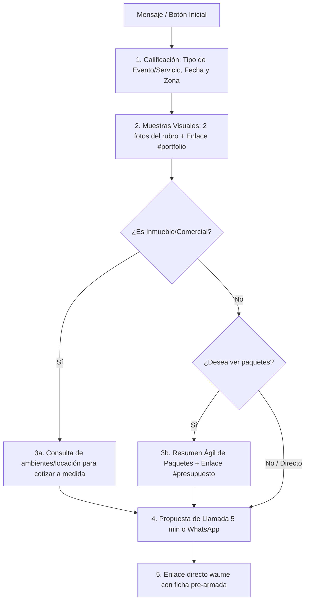

# Especificación Funcional: Chatbot de Captación y Calificación (NEO Producciones)

## 1. Propósito y Alcance
Automatizar la primera línea de atención en Instagram Direct y Facebook Messenger para @neo_producciones_tm, guiando al prospecto desde la curiosidad inicial hasta la calificación completa y la derivación a WhatsApp o llamada de 5 minutos, con la voz y estética de Jorge.

---

## 2. Clasificación de Servicios y Reglas de Paquetes
Alineado 1:1 con el Wizard de presupuestos de la web (`neoproduccionestm.netlify.app`):

1. **Eventos Sociales (`sociales`):**
   - Subtipos: Bodas, 15 años, Bar/Bat Mitzvá, 18 años, Primer Añito, Bautismos, Comuniones, Aniversarios.
   - Aplican paquetes prearmados (Esencial, Clásico, Premium) o personalización a medida.
2. **Eventos Corporativos (`corporativos`):**
   - Conferencias, congresos, jornadas empresariales. Aplican paquetes por tiempo y cobertura.
3. **Sesiones & Books (`sesiones`):**
   - Pre-boda, book de 15, retratos personales. Aplican paquetes de sesión.
4. **Fotografía Comercial & Inmobiliaria (`comercial`):**
   - Inmuebles, arquitectura, espacios y productos.
   - **Regla Exclusiva:** NO aplican paquetes de fiesta. Se cotiza a medida según cantidad de ambientes, metraje y locación.

---

## 3. Flujo Principal de Estados (Happy Path)

---

## 4. Criterios de Aceptación (Gherkin)

### Escenario 1: Ingreso por Anuncio o Botón FAQ (Ruptura de Bucle)
* **Dado** que un usuario presiona un botón automático o escribe por primera vez,
* **Cuando** el chatbot procesa el evento,
* **Entonces** saluda cordialmente en voseo rioplatense, valida el tipo de servicio y solicita fecha estimada y zona/salón, bloqueando envíos duplicados si el usuario presiona el botón repetidamente.

### Escenario 2: Entrega de Material Visual Segmentado
* **Dado** que el usuario informa su tipo de evento (ej. Bautismo, 15 años, Boda, Inmueble),
* **Cuando** el chatbot detecta la categoría,
* **Entonces** responde felicitando, envía 2 fotografías reales de referencia de esa categoría y facilita el enlace `https://neoproduccionestm.netlify.app/#portfolio`.

### Escenario 3: Tratamiento Diferenciado de Fotografía Inmobiliaria
* **Dado** que el prospecto consulta por fotografía de inmuebles o comercial,
* **Cuando** solicita presupuesto,
* **Entonces** el chatbot aclara que este servicio se presupuesta a medida según ambientes y metraje (sin paquetes de fiesta) y ofrece coordinar directamente con Jorge.

### Escenario 4: Consulta de Paquetes para Eventos Sociales y Corporativos
* **Dado** que el usuario de un evento social o corporativo solicita conocer valores,
* **Cuando** el chatbot presenta la información,
* **Entonces** expone un resumen ágil de las 3 opciones (Esencial, Clásico y Premium) e invita a personalizar adicionales en `https://neoproduccionestm.netlify.app/#presupuesto`.

### Escenario 5: Cierre con Doble Alternativa y WhatsApp
* **Dado** que el prospecto fue calificado y vio las opciones,
* **Cuando** se busca concretar la reserva,
* **Entonces** el chatbot ofrece agendar una llamada telefónica de 5 minutos o continuar por WhatsApp mediante `https://wa.me/541140686925`.

---

## 5. Invariantes y Reglas de Negocio
1. **Anti-Duplicación:** Si un usuario presiona el mismo botón en menos de 10 segundos, no se reenvía el mismo mensaje.
2. **Pausa ante Intervención Humana:** Si Jorge escribe manualmente en el chat, el bot se desactiva en esa conversación por 24 horas.
3. **No Muros de Texto:** Ningún mensaje del bot superará las 6 líneas o 70 palabras.
