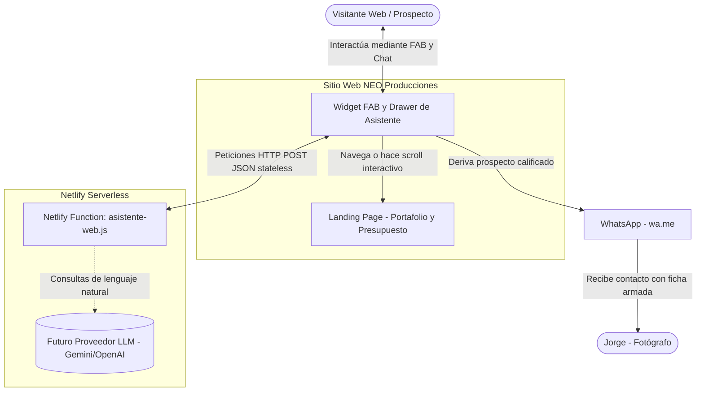
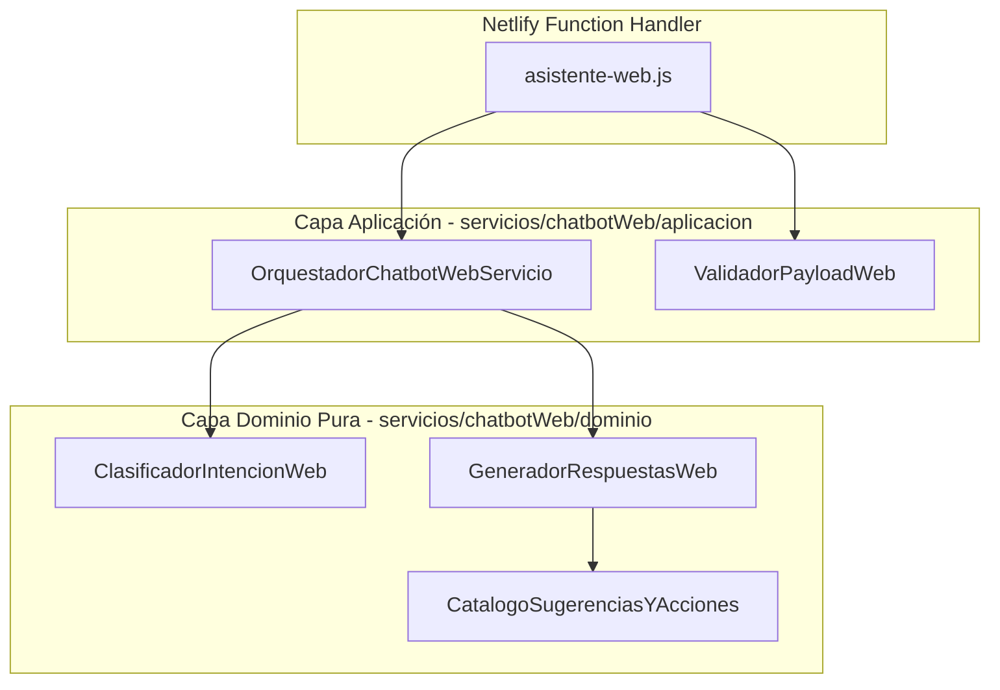

# Arquitectura C4: Asistente y Chatbot Web NEO Producciones

## Nivel 1: Contexto del Sistema
Delimita los actores humanos, el sistema web y las integraciones externas.



---

## Nivel 2: Contenedores
Estructura de ejecución y despliegue del asistente web en Netlify.

```mermaid
flowchart TD
    subgraph ClienteNavegador [Frontend SPA - Vanilla JS]
        FAB[BotonFlotanteAsistente.js]
        Drawer[VentanaChatAsistente.js]
        AlmacenSesion[(sessionStorage: Historial y Estado)]
    end

    subgraph PlataformaNetlify [Netlify Serverless Infrastructure]
        EndpointWeb["Endpoint: /.netlify/functions/asistente-web"]
        ModuloServicios["Capa de Servicios: servicios/chatbotWeb/"]
    end

    FAB <-->|Abre / Cierra| Drawer
    Drawer <-->|Persiste estado efímero| AlmacenSesion
    Drawer <-->|POST JSON { mensaje, historial, prospecto }| EndpointWeb
    EndpointWeb -->|Invoca| ModuloServicios
```

---

## Nivel 3: Componentes (Clean Architecture en servicios/chatbotWeb/)



---

## Nivel 4: Código y Contratos

### 1. Contrato de Entrada (POST a `/.netlify/functions/asistente-web`)
```json
{
  "textoMensaje": "Hola, cuánto sale un casamiento?",
  "historial": [
    { "rol": "asistente", "texto": "¡Hola! ¿Qué evento estás planeando?" }
  ],
  "prospecto": {
    "rubro": "",
    "subTipo": "",
    "fechaEstimada": "",
    "zonaSalon": ""
  }
}
```

### 2. Contrato de Salida (Respuesta JSON)
```json
{
  "texto": "¡Hola! Para casamientos tenemos coberturas completas...",
  "sugerencias": ["Ver fotos de casamientos", "Calcular presupuesto", "Hablar por WhatsApp"],
  "prospecto": {
    "rubro": "sociales",
    "subTipo": "casamiento"
  },
  "accionUi": {
    "tipo": "SCROLL_A_SECCION",
    "destino": "#presupuesto"
  }
}
```
