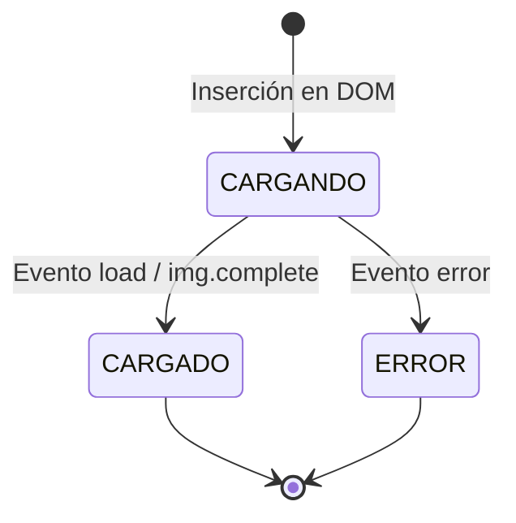

# Modelo de Dominio y Glosario Ubicuo: Portafolio Multimedia

**Módulo**: Portafolio Multimedia  
**Documento**: `docs/dominio.md`  
**Fecha**: 2026-10-15  

---

## 1. Glosario Ubicuo (Ubiquitous Language)
- **ItemMultimedia**: Entidad representativa de una pieza audiovisual expuesta en el portafolio (fotografía previa, fotografía de evento, panorama 360° o video).
- **EstadoCarga**: Objeto de valor que modela el ciclo de vida de renderizado del recurso multimedia:
  - `CARGANDO` (*Loading*): El recurso está en tránsito de red; se despliega el esqueleto visual animado (*skeleton*).
  - `CARGADO` (*Loaded*): El recurso gráfico fue decodificado y está listo para ser visualizado; se activa la transición a visible (*fade-in*).
  - `ERROR` (*Error*): Ocurrió un fallo en la obtención del recurso; se retira la animación de esqueleto para prevenir estados suspendidos.
- **EsqueletoCarga (Skeleton Screen)**: Representación esquemática temporal que replica las dimensiones exactas (`aspect-ratio: 1/1` o `16/9`) y la forma del elemento final mediante un patrón cromático "Grises Pro" animado.

---

## 2. Diagrama Entidad-Relación y Ciclo de Estados

---

## 3. Invariantes del Dominio
1. **Invariante de Estabilidad Geométrica**: Todo contenedor de `ItemMultimedia` debe preservar su relación de aspecto antes, durante y después de la carga para garantizar un CLS (Cumulative Layout Shift) de 0.
2. **Invariante de Accesibilidad Sensorial**: La animación shimmer debe respetar la consulta de medios `prefers-reduced-motion`.
3. **Invariante de No-Persistencia de Skeleton**: Bajo ninguna circunstancia el efecto de esqueleto debe mantenerse activo tras completarse el evento `load` o `error`.
